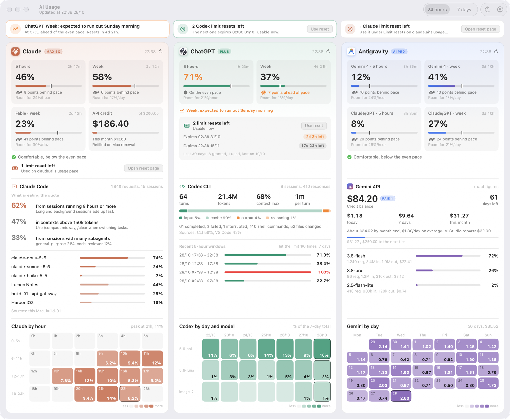

<p align="center">
  
</p>

<h1 align="center">AIUsage</h1>

<p align="center">
  A quota and cost dashboard for AI services on macOS: Claude, ChatGPT/Codex, Antigravity and the Gemini API in one window and one widget.<br>
  See how much quota is left, when it resets, where it is going and how much money remains, without opening each website.
</p>

<p align="center">
  
  
  
  
</p>

<p align="center">
  <a href="README.md">Tiếng Việt</a> · <b>English</b> · <a href="CHANGELOG.en.md">Changelog</a> · <a href="docs/DEVELOPMENT.md">Developer notes (Vietnamese)</a> · <a href="https://phatdev.net/en/docs/aiusage">Online docs</a>
</p>

**Version:** 0.9.0 · **Requires:** macOS 26 or later · **Interface:** English and Vietnamese, following the macOS language



---

## Overview

AIUsage brings the usage numbers of several AI services into one place. A single window shows everything with no tabs to click through: what needs attention at the top, then one column per company with quotas, money and resets, detailed analytics and a heat map. A large desktop widget shows the percentage used and the time left until each reset.

Three design principles:

- **No official API needed when the vendor has none.** Claude and AI Studio only have web pages, so the app reads those pages in a signed-in WKWebView (the Safari engine). Codex uses the same API the Codex app calls. Antigravity is read from the `agy` CLI.
- **Old numbers must look old.** Each source has its own fetch time; after 90 minutes without a refresh its column shows a warning, so one broken source cannot hide behind the others.
- **Your data stays on your Mac.** There is no intermediate server. Keys live in the Keychain or in each CLI's own sign-in file; the app and widget only read a local cache file.

## Features

| Area | What you get |
|---|---|
| **Needs attention** | A strip at the top lists, automatically: quotas close to their limit or projected to run out before the reset, limit resets left, sources that need signing in again, stale data, a Gemini balance that only lasts a few more days, unusual spending, SSH hosts that cannot be reached. Each item has its action button right there. |
| **Quotas** | Claude (5 hours, week, per-model weekly limits such as Fable, the Max plan's 200 USD monthly API credit), ChatGPT/Codex (5 hours, week), Antigravity (Gemini and Claude/GPT, 5 hours and week). Each tile shows the percentage used, time to reset, an even-pace marker, how far ahead or behind the even pace you are, and the hourly or daily rate that still avoids hitting the limit. |
| **Limit resets** | Codex: credits left, which can be used now, each credit's expiry, and a button to spend one (always confirmed first). Claude: credits left and a button that opens claude.ai's reset page. The button hides when none are left. |
| **Claude Code analytics** | Share of usage from sessions running more than 8 hours, from contexts above 150k and from subagents, by model, by project and by hour. Combines sessions on this Mac, in Cowork and on SSH hosts. |
| **Codex CLI** | Turns, tokens (input, cache, output, reasoning), peak context, turn outcomes, commands and file edits, recent 5-hour windows from OpenAI's servers, usage by day and model. |
| **Gemini API** | Credit balance, days the balance lasts, spend today, over 7 days and this month (exact from BigQuery when available, estimated while the export lags), month-end forecast, progress to the next tier, spend by model, a 30-day spending calendar. Works with any billing currency. |
| **Widget** | Large size, per-second countdown in the last hour, refresh button, follows light and dark mode, refreshes every 5 minutes. |
| **Bilingual** | The interface, widget and sign-in windows come in English and Vietnamese and follow the macOS language. To run AIUsage in a different language from the system: **System Settings > General > Language & Region > Applications**, add AIUsage. |
| **Accounts window** | One panel per source: connection status, sign-in button (hidden once signed in), on/off switch, Gemini settings with a step-by-step key guide, and SSH hosts with their own name, address, user, port and key. |

## Installation

1. Download `AIUsage-0.9.0.dmg` from [Releases](https://github.com/PhatLam1108/AIUsage/releases), open it and drag **AIUsage** into **Applications**. The release runs on both Apple Silicon and Intel Macs.
2. Open AIUsage. This build is not notarized by Apple yet, so macOS blocks the first launch. Go to **System Settings > Privacy & Security**, scroll down, click **Open Anyway**, then open the app again. Or run:

   ```bash
   xattr -dr com.apple.quarantine /Applications/AIUsage.app
   ```
3. On first launch the app installs its background runtime into `~/Library/Application Support/AIUsage` (fetch scripts, the sign-in helper and 3 LaunchAgents that refresh every 5 minutes) and opens the **Accounts** window.
4. Add the widget: right-click the desktop > **Edit Widgets** > search for **AI Usage**.

`python3` is required (it comes with the Command Line Tools: `xcode-select --install`).

## Connecting sources

Everything happens in the **Accounts** window (the person icon at the top right, or `Cmd+,`). Each source can be switched on or off; a source that is off is not fetched and not shown.

| Source | How to connect |
|---|---|
| **Claude** | Click **Sign in** and a claude.ai window opens. Choose **Continue with email** (Google sign-in is blocked inside a WebView). The window closes by itself once you are in. |
| **Anthropic Console** | Click **Sign in** in the Console panel to read the API credit balance. |
| **ChatGPT / Codex** | Run `codex login` in Terminal (the app has a button that opens it). The app reads the token in `~/.codex/auth.json`. |
| **Antigravity** | Sign in to the `agy` CLI once. |
| **Gemini API** | Enter the Project ID, billing account and BigQuery table (optional), then pick the service account JSON key; the key is stored in the Keychain. The panel includes a step-by-step guide to creating the key, about 5 minutes. |
| **SSH hosts** | Add each host with a name, address (or a name from `~/.ssh/config`), user, port and key. No key yet? Click **Install SSH key**: Terminal opens so you can type the server password once. The host only needs `python3`; nothing else is installed. |

## Security and privacy

- No API keys or passwords in the source code. The service account key is in the Keychain; the Codex token is read from `codex`'s own sign-in file; claude.ai and AI Studio sessions live in the helper's data store.
- Nothing is sent to any server run by this project. The cache only holds usage numbers and stays in your home folder.
- The widget runs sandboxed: it only reads the cache and writes a trigger file when you press refresh.
- For SSH hosts the app signs in with keys only, never stores passwords, and only runs the session-log reader, sent over the SSH session itself. The only file left on the host is a small state file in `~/.cache`.
- Spending a limit reset always asks for confirmation first, because a used credit cannot be recovered.

## Building from source

Xcode 26 or later. Open `AIUsage.xcodeproj`, choose your signing team, and build the **AIUsage** scheme. Package a release with `scripts/build-dmg.sh`. Architecture, data sources and known pitfalls are in the [developer notes](docs/DEVELOPMENT.md) (Vietnamese).

```
AIUsage/          SwiftUI app: dashboard, Accounts window, runtime installer
AIUsageWidget/    large widget and refresh / sign-in App Intents
ClaudeHelper/     source of the WKWebView helper
runtime/          fetch scripts (bash, Python), bundled into the app at build time
scripts/          build phase and DMG packaging script
docs/             developer notes, logo, screenshots
```

## Documentation

- [Online documentation](https://phatdev.net/en/docs/aiusage): a guide to every feature, in English and Vietnamese
- [Developer notes](docs/DEVELOPMENT.md) (Vietnamese)
- [Changelog](CHANGELOG.en.md) · [Nhật ký thay đổi](CHANGELOG.md)

## Contributors

| | Role |
|---|---|
| **Steven Lam** ([@PhatLam1108](https://github.com/PhatLam1108)) | Author: product planning and direction, architecture, real-world testing and releases |
| **Claude** ([Anthropic](https://www.anthropic.com/claude)) | Wrote the code following Steven Lam's plan and architecture, via [Claude Code](https://claude.com/claude-code) |
| **Gemini** ([Google](https://deepmind.google/models/gemini/)) | UI refinements, via [Antigravity](https://antigravity.google) |
| **Codex** ([OpenAI](https://openai.com/codex)) | Code review and bug reports |

## License

[MIT](LICENSE) ([Vietnamese translation](LICENSE.vi.md)). You may use, modify and redistribute it, including commercially, as long as the copyright notice is kept.

## Note

AIUsage is not affiliated with Anthropic, OpenAI or Google; service names and logos belong to their respective owners.
