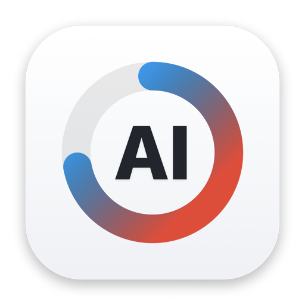
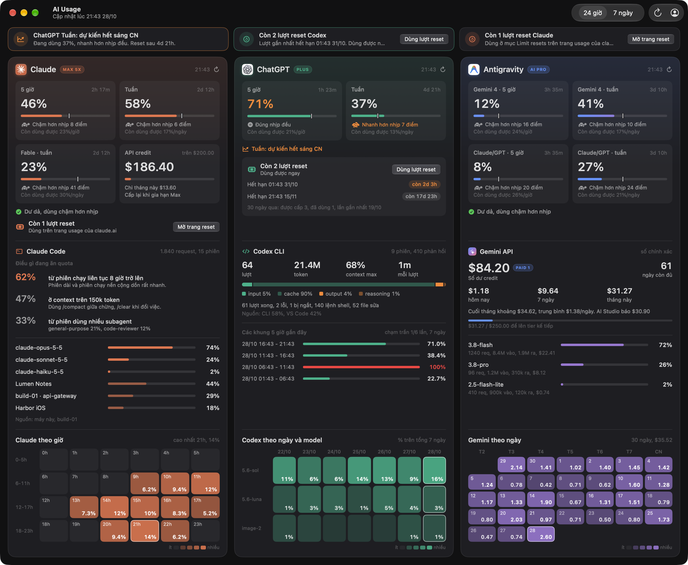

<p align="center">
  
</p>

<h1 align="center">AIUsage</h1>

<p align="center">
  Bảng theo dõi hạn mức và chi phí AI trên macOS: Claude, ChatGPT/Codex, Antigravity và Gemini API trong một cửa sổ và một widget.<br>
  Xem còn bao nhiêu quota, bao giờ reset, đang tiêu vào đâu và còn bao nhiêu tiền, không phải mở từng trang web.
</p>

<p align="center">
  
  
  
  
</p>

<p align="center">
  <b>Tiếng Việt</b> · <a href="README.en.md">English</a> · <a href="CHANGELOG.md">Nhật ký thay đổi</a> · <a href="docs/DEVELOPMENT.md">Ghi chú phát triển</a> · <a href="https://phatdev.net/docs/aiusage">Tài liệu trực tuyến</a>
</p>

**Phiên bản:** 0.9.0 · **Yêu cầu:** macOS 26 trở lên · **Giao diện:** tiếng Việt và tiếng Anh, theo ngôn ngữ của macOS



---

## Giới thiệu

AIUsage gom số liệu sử dụng của các dịch vụ AI vào một chỗ. Một cửa sổ duy nhất hiện mọi thứ, không có tab nào phải bấm: trên cùng là những việc cần chú ý, bên dưới là một cột cho mỗi hãng gồm hạn mức, tiền và lượt reset, phân tích chi tiết và heat map. Một widget cỡ lớn trên màn hình nền hiện phần trăm đã dùng và thời gian còn lại tới lần reset.

Ba nguyên tắc thiết kế:

- **Không cần API chính thức khi hãng không có.** Claude và AI Studio chỉ có trang web, nên app đọc chính trang đó bằng một WKWebView (engine Safari) đã đăng nhập. Codex dùng API mà app Codex đang gọi. Antigravity đọc từ CLI `agy`.
- **Số cũ phải lộ ra là số cũ.** Mỗi nguồn có mốc lấy dữ liệu riêng; quá 90 phút chưa làm mới thì cột đó hiện cảnh báo, để một nguồn hỏng không bị các nguồn khác che đi.
- **Dữ liệu ở lại trên máy.** Không có máy chủ trung gian. Khoá nằm trong Keychain hoặc file đăng nhập của chính từng CLI; app và widget chỉ đọc một file cache cục bộ.

## Tính năng

| Mảng | Nội dung |
|---|---|
| **Cần chú ý** | Dải trên cùng tự liệt kê: hạn mức sắp chạm trần hoặc dự kiến hết trước giờ reset, lượt reset còn lại, nguồn cần đăng nhập lại, số liệu cũ, số dư Gemini chỉ còn ít ngày, chi tiêu bất thường, máy chủ không kết nối được. Mỗi mục có nút xử lý ngay tại chỗ. |
| **Hạn mức** | Claude (5 giờ, tuần, hạn mức tuần theo model như Fable, API credit 200 USD/tháng của gói Max), ChatGPT/Codex (5 giờ, tuần), Antigravity (Gemini và Claude/GPT, 5 giờ và tuần). Mỗi ô có % đã dùng, thời gian tới reset, vạch nhịp đều, so với nhịp đều (nhanh hay chậm bao nhiêu điểm) và mức còn dùng được mỗi giờ hoặc mỗi ngày để không chạm trần. |
| **Lượt reset** | Codex: số lượt còn lại, lượt nào dùng được ngay, hạn dùng của từng lượt, nút dùng lượt reset (luôn hỏi xác nhận). Claude: số lượt còn lại và nút mở trang reset của claude.ai. Hết lượt thì nút tự ẩn. |
| **Phân tích Claude Code** | Tỷ lệ dùng từ phiên chạy liên tục hơn 8 giờ, từ context trên 150k và từ subagent, theo model, theo project, theo giờ. Gộp phiên trên máy này, trong Cowork và trên các máy chủ SSH. |
| **Codex CLI** | Lượt, token (input, cache, output, reasoning), context cao nhất, kết quả lượt, lệnh và file đã sửa, các khung 5 giờ gần đây theo số liệu máy chủ OpenAI, mức dùng theo ngày và model. |
| **Gemini API** | Số dư credit, số ngày số dư còn đủ, chi hôm nay, 7 ngày và tháng (chính xác từ BigQuery khi có, ước tính khi export trễ), dự báo cuối tháng, tiến độ lên tier kế tiếp, chi theo model, lịch chi 30 ngày. Hỗ trợ mọi loại tiền của tài khoản billing. |
| **Widget** | Cỡ lớn, đếm ngược từng giây khi dưới 1 giờ, nút làm mới, sáng tối theo hệ thống, tự cập nhật mỗi 5 phút. |
| **Song ngữ** | Giao diện, widget và cửa sổ đăng nhập có tiếng Việt và tiếng Anh, tự theo ngôn ngữ của macOS. Muốn AIUsage dùng ngôn ngữ khác hệ thống: **System Settings > General > Language & Region > Applications**, thêm AIUsage. |
| **Cửa sổ Tài khoản** | Một khung riêng cho từng nguồn: trạng thái kết nối, nút đăng nhập (ẩn khi đã đăng nhập), bật tắt nguồn, thông tin Gemini kèm hướng dẫn tạo khoá từng bước, danh sách máy chủ SSH với tên, địa chỉ, user, cổng và khoá riêng từng máy. |

## Cài đặt

1. Tải `AIUsage-0.9.0.dmg` ở trang [Releases](https://github.com/PhatLam1108/AIUsage/releases), mở file và kéo **AIUsage** vào thư mục **Applications**. Bản phát hành chạy được trên cả Mac Apple Silicon và Intel.
2. Mở AIUsage. Bản này chưa được Apple notarize, nên lần đầu macOS sẽ chặn. Vào **System Settings > Privacy & Security**, kéo xuống và bấm **Open Anyway**, rồi mở lại app. Hoặc chạy lệnh:

   ```bash
   xattr -dr com.apple.quarantine /Applications/AIUsage.app
   ```
3. Lần mở đầu tiên, app tự cài phần chạy nền vào `~/Library/Application Support/AIUsage` (script lấy số liệu, helper đăng nhập và 3 LaunchAgent làm mới mỗi 5 phút) rồi mở cửa sổ **Tài khoản**.
4. Thêm widget: chuột phải lên màn hình nền > **Edit Widgets** > tìm **AI Usage**.

Cần có `python3` (cài kèm Command Line Tools: `xcode-select --install`).

## Kết nối các nguồn

Mọi thao tác nằm trong cửa sổ **Tài khoản** (biểu tượng người ở góc phải, hoặc `Cmd+,`). Mỗi nguồn có thể bật hoặc tắt riêng; nguồn tắt thì không lấy số và không hiện trên bảng.

| Nguồn | Cách kết nối |
|---|---|
| **Claude** | Bấm **Đăng nhập**, một cửa sổ claude.ai mở ra. Chọn **Continue with email** (đăng nhập Google bị chặn trong WebView). Cửa sổ tự đóng khi đã vào được. |
| **Anthropic Console** | Bấm **Đăng nhập** ở khung Console để đọc số dư API credit. |
| **ChatGPT / Codex** | Chạy `codex login` trong Terminal (app có nút mở sẵn lệnh). App đọc token trong `~/.codex/auth.json`. |
| **Antigravity** | Đăng nhập CLI `agy` một lần. |
| **Gemini API** | Nhập Project ID, billing account và bảng BigQuery (tuỳ chọn), rồi chọn file khoá service account JSON; khoá được lưu vào Keychain. Khung này có hướng dẫn tạo khoá từng bước, khoảng 5 phút. |
| **Máy chủ SSH** | Thêm từng máy với tên, địa chỉ (hoặc tên trong `~/.ssh/config`), user, cổng và khoá. Chưa có khoá thì bấm **Cài khoá SSH**: Terminal mở ra để bạn nhập mật khẩu máy chủ một lần. Máy chủ chỉ cần `python3`, không phải cài gì thêm. |

## Bảo mật và quyền riêng tư

- Không có khoá API hay mật khẩu trong mã nguồn. Khoá service account nằm trong Keychain; token Codex đọc từ file đăng nhập của chính `codex`; phiên claude.ai và AI Studio nằm trong data store của helper.
- Không có dữ liệu nào gửi tới máy chủ của dự án này. Cache chỉ chứa số liệu sử dụng và nằm trong thư mục người dùng.
- Widget chạy trong sandbox: chỉ đọc cache và ghi một file kích hoạt khi bấm làm mới.
- Với máy chủ SSH, app chỉ đăng nhập bằng khoá, không lưu mật khẩu, và chỉ chạy script đọc nhật ký phiên (gửi qua chính phiên SSH). Trên máy chủ chỉ có một file trạng thái nhỏ trong `~/.cache`.
- Dùng lượt reset luôn hỏi xác nhận trước, vì lượt đã dùng không lấy lại được.

## Build từ mã nguồn

Cần Xcode 26 trở lên. Mở `AIUsage.xcodeproj`, chọn team ký của bạn, rồi build scheme **AIUsage**. Đóng gói bản phát hành bằng `scripts/build-dmg.sh`. Chi tiết kiến trúc, nguồn dữ liệu và các bẫy đã gặp nằm trong [ghi chú phát triển](docs/DEVELOPMENT.md).

```
AIUsage/          app SwiftUI: bảng điều khiển, cửa sổ Tài khoản, phần cài chạy nền
AIUsageWidget/    widget cỡ lớn và App Intent làm mới, đăng nhập
ClaudeHelper/     mã nguồn helper WKWebView
runtime/          script lấy số liệu (bash, Python), đóng gói vào app khi build
scripts/          build phase và script tạo DMG
docs/             ghi chú phát triển, logo, ảnh chụp
```

## Tài liệu

- [Tài liệu trực tuyến](https://phatdev.net/docs/aiusage): hướng dẫn từng tính năng, song ngữ
- [Ghi chú phát triển](docs/DEVELOPMENT.md)
- [Nhật ký thay đổi](CHANGELOG.md) · [Changelog (English)](CHANGELOG.en.md)

## Người đóng góp

| | Vai trò |
|---|---|
| **Steven Lam** ([@PhatLam1108](https://github.com/PhatLam1108)) | Tác giả: lên kế hoạch và định hướng sản phẩm, thiết kế kiến trúc, kiểm thử thực tế và phát hành |
| **Claude** ([Anthropic](https://www.anthropic.com/claude)) | Viết code theo kế hoạch và kiến trúc của Steven Lam, qua [Claude Code](https://claude.com/claude-code) |
| **Gemini** ([Google](https://deepmind.google/models/gemini/)) | Chỉnh giao diện, qua [Antigravity](https://antigravity.google) |
| **Codex** ([OpenAI](https://openai.com/codex)) | Review code, góp ý về lỗi |

## Giấy phép

[MIT](LICENSE) ([bản dịch tiếng Việt](LICENSE.vi.md)). Bạn được dùng, sửa, phân phối lại, kể cả cho mục đích thương mại, miễn là giữ thông báo bản quyền.

## Lưu ý

AIUsage không liên kết với Anthropic, OpenAI hay Google; tên và logo các dịch vụ thuộc về chủ sở hữu tương ứng.
